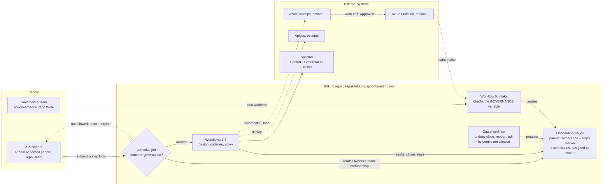
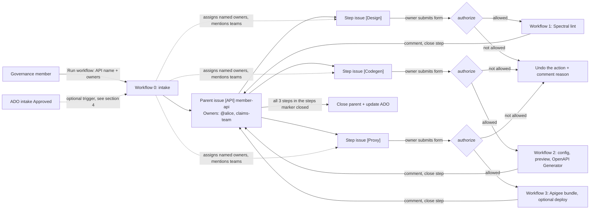
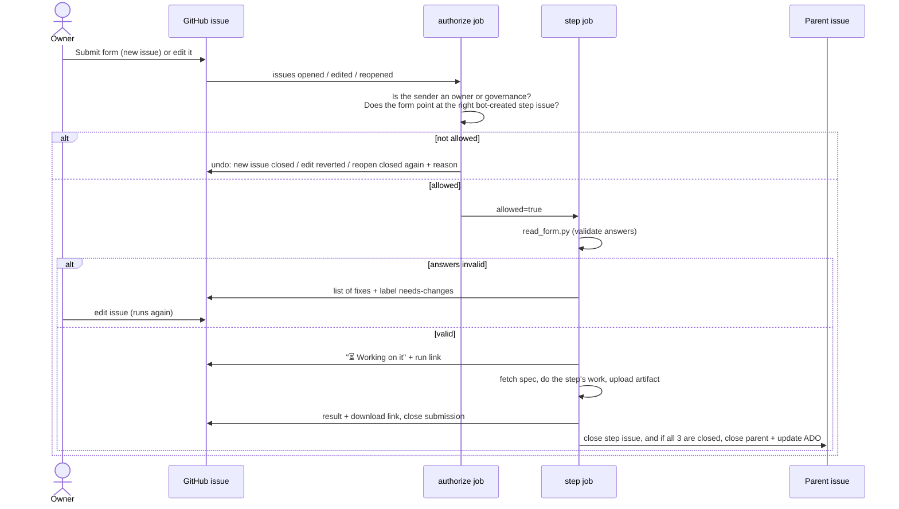

# API onboarding automation (POC)

One approved API intake → one GitHub tracking issue with three steps: **design check**, **code generation**, **Apigee proxy**.
The owning team fills in a short form for each step. The automation does the rest and reports back to GitHub (and ADO, if configured).
Nobody needs to read the docs or watch the video.

**Repo:** `deepaksetiaorg/api-onboarding-poc` (private). **Test evidence:** [TEST-RESULTS.md](TEST-RESULTS.md).

**Contents:**
[Overview](#1-overview) ·
[Design](#2-design) ·
[Approach and decisions](#3-approach-and-key-decisions) ·
[Ways to start the intake](#4-ways-to-start-the-intake) ·
[Setup](#5-setup) ·
[How to use](#6-how-to-use) ·
[How to test](#7-how-to-test) ·
[Troubleshooting](#8-troubleshooting) ·
[Existing pipelines and roadmap](#9-plugging-in-existing-pipelines-and-roadmap) ·
[Limits and production hardening](#10-limits-and-production-hardening)

---

## 1. Overview

**Problem.** Onboarding an API means three separate activities (design review, code generation, gateway proxy), each with its own repo and hand-written YAML. Teams have to know which repos exist, in what order, and what each config file looks like. Mistakes show up late, as pipeline failures.

**What this POC does.**
- The **governance team** starts an onboarding for an API and names its **owners**.
- The bot creates one **parent tracking issue** and three **step issues**, each with a pre-filled form link.
- **Only the owners** (or governance) can submit those forms. Answers are validated with plain-language fix messages before anything runs.
- Each step runs automatically, posts its result (lint report, class-name preview, download links) and closes itself. When all three are done the parent closes, and ADO is updated if configured.

---

## 2. Design

### 2.1 Architecture

**System view:** who and what is involved. Everything inside the GitHub box runs in the repo, with no servers to host.



**Onboarding flow:** what happens to one API.



The **Guard** workflow sits beside this flow. It undoes close, reopen and edit actions on the parent, step and submission issues by anyone not allowed to make them (section 2.6, rule 3).

### 2.2 Components

| Path | Role |
|---|---|
| `.github/workflows/intake.yml` | **Workflow 0.** Checks the person is in governance, creates the parent issue and 3 linked sub-issues |
| `.github/workflows/step-design.yml` | **Workflow 1.** `authorize` job, then lints the spec with Spectral using `.spectral.yaml` |
| `.github/workflows/step-codegen.yml` | **Workflow 2.** `authorize` job, then builds `codegen.yaml`, previews class names, runs OpenAPI Generator, uploads the code |
| `.github/workflows/step-proxy.yml` | **Workflow 3.** `authorize` job, then builds an Apigee proxy bundle, uploads it, optionally deploys |
| `.github/workflows/guard.yml` | Undoes close/reopen/edit of parent, step and submission issues by people not allowed to, and closes the parent when the last step is closed by hand |
| `.github/ISSUE_TEMPLATE/` | The three forms (`design-request.yml`, `codegen-request.yml`, `proxy-request.yml`) |
| `.github/CODEOWNERS` | Asks `api-governance` to review changes to `.github/` and `scripts/` (enforced only with branch protection) |
| `.spectral.yaml` | API design rules used by the design check |
| `scripts/authorize.py` | Access control: governance check for the intake, owner check for every form, guard rules, owner/assignee sync |
| `scripts/create_api_request.py` | Creates the parent + step issues, writes the Owners line and `steps` marker, assigns named owners, mentions owner teams, warns about unassignable owners |
| `scripts/read_form.py` | Parses a submitted form and validates every answer |
| `scripts/fetch_spec.py` | Fetches the spec (repo path, GitHub URL or https URL) and checks it is OpenAPI 3.x |
| `scripts/lint_report.py` | Turns Spectral JSON into a short markdown report |
| `scripts/codegen.py` | Builds the codegen config + class-name preview, runs OpenAPI Generator in Docker |
| `scripts/generate_proxy.py` | Builds the Apigee proxy bundle from the spec |
| `scripts/report.py` | Posts results, closes issues, closes the parent when all steps are done, updates ADO |
| `scripts/common.py` | Shared helpers: GitHub API, ADO API, form parsing, hidden markers, a parent's step issues |
| `scripts/test_authorize.py` | Unit tests for access control, guard, assignment and the steps marker |
| `scripts/demo_trigger.sh` | Starts an intake from the command line (option B) |
| `azure-function/` | Optional: starts the intake automatically from an ADO approval (option C) |
| `specs/member-api.yaml` | Sample spec for demos and tests |
| `TEST-RESULTS.md` | What was tested, when, and which issues prove it |

All logic is plain Python (standard library + PyYAML). Workflows only need `pip install pyyaml`.

### 2.3 Issue model

Three kinds of issues work together:

| Issue | Created by | Title | Labels | Carries |
|---|---|---|---|---|
| **Parent** (tracking) | Bot (intake) | `[API] member-api` | `api-request` | Visible `**Owners:**` line (e.g. `` `@alice`, `claims-team` ``), spec, requester, ADO id, hidden `steps` marker (the step issue numbers). Step issues are also attached as native **sub-issues**, which gives a progress bar. |
| **Step** (one per step) | Bot (intake) | `[Design] / [Codegen] / [Proxy] member-api` | `api-step`, `step:<step>` | "Fill in the details here" link and hidden markers: `parent`, `step`, `api`, `ado`. **Assigned** to the individual owners |
| **Submission** (the filled form) | Owner or governance | `[Codegen] member-api` | `design-request` / `codegen-request` / `proxy-request` | Form answers, including the pre-filled API name and **tracking issue number** (= the step issue) |

**Hidden markers** are HTML comments in a bot-created issue body, for example `<!-- parent:5 -->` and `<!-- api:member-api -->`. They let the scripts move from a submission to its step issue to its parent without a database. They are only trusted on issues created by `github-actions[bot]`.

**Sub-issues are for display only.** GitHub doesn't document who can attach or detach sub-issues; Triage and above can close, reopen and assign any issue, so assume they can. Nothing that decides anything reads the sub-issue list. "All steps done → close parent + ADO Done" and owner/assignee sync use the parent's `steps` marker, which only governance can edit (it's on the guarded parent). Detaching a step therefore only affects the progress bar, and can't make an onboarding look complete. Parents created before the marker existed fall back to the sub-issue list.

**Labels** are created by the intake workflow: `api-request`, `api-step`, `step:design|codegen|proxy`, `design-request|codegen-request|proxy-request`, `needs-changes`.

### 2.4 Lifecycle of a form submission



- All three step workflows listen to every issue event. The label check means only the matching one does any work (the others show as **skipped**).
- **Edits re-run the step.** A newer *allowed* edit cancels a run still in progress for the same issue. The cancel rule (`concurrency`) sits on the step job, not the workflow, so a rejected edit by someone else can never cancel the owner's run.
- On an unexpected error the bot comments "❌ Something went wrong on our side" with the run log, and posts the same to ADO if configured.

### 2.5 What each step does

| Step | Input | Work | Output |
|---|---|---|---|
| **Design** | Spec location, audience, data sensitivity | Spectral lint with `.spectral.yaml` (`spectral:oas` + house rules: tags, operationIds, PascalCase schemas, kebab-case paths, `security` defined) | "Design check passed" with suggestions, or a table of errors to fix |
| **Codegen** | Server or client, language, package, group/artifact id, class suffixes, class renames, options | Writes `work/codegen.yaml`, previews class names, runs `openapitools/openapi-generator-cli:v7.10.0` in Docker | Class-name preview + downloadable code (includes `codegen.yaml` for traceability) |
| **Proxy** | Base path, backend URL, environment, auth type, rate limit | Builds an Apigee bundle: API key or OAuth check, spike arrest, one flow per operation, 404 for anything else | Bundle zip to download; deploys to Apigee if `APIGEE_ORG` is set |

### 2.6 Access control and trust model

| Who | Can do | How it's enforced |
|---|---|---|
| **Governance team** | Start an onboarding, fill in or fix any API's forms, change owners, close/reopen/edit any onboarding issue | Repo **Write** access + listed in the `GOVERNANCE` repo variable |
| **API owners** | Fill in the step forms for *their* API only, close/reopen *their* step issues (e.g. to skip a step) | Listed on the parent issue's `**Owners:**` line. Repo **Read** or **Triage** access is enough |
| Anyone else with access | Open and read issues | Nothing runs, and their action is undone (see below) so the owner isn't affected |

How `scripts/authorize.py` decides:

1. **Intake (`governance` mode):** the person who clicked Run workflow (`github.actor`) must be in `GOVERNANCE`, or the run fails. `repository_dispatch` (option B/C) is not checked here, because sending it already needs a token with write access.
2. **Every form submit, edit or reopen (`design|codegen|proxy` mode):**
   - The form's tracking issue must exist, be **created by the bot**, and be a step issue for **the same step**. This stops someone creating a fake step issue that lists themselves as owner.
   - The form's API name must match the step issue's `api` marker. This stops someone pointing their form at another team's issue.
   - The owners are read from the **parent** issue's `**Owners:**` line.
   - The person who triggered the event (`github.event.sender`, so the editor for edits, not the original author) must be an owner or in `GOVERNANCE`.
   - If any check fails, the step job is skipped and the action is **undone, so the owner is never affected by someone else's action**:

     | Rejected action | What the bot does |
     |---|---|
     | **Opened** a new submission | It's their own issue: comments "🔒 Not run: reason" and closes it as *not planned* |
     | **Edited** someone's submission | Restores the previous title and body (from the edit event), leaves the issue open or closed as it was, comments "↩️ Reverted @user's edit". Edits on **closed** submissions are checked too, so completed records can't be altered |
     | **Reopened** someone's closed submission | Closes it again with the reason it had before (e.g. *completed*), comments "↩️ Closed again" |

     The bot's own revert doesn't trigger another run, because changes made with the workflow token don't start workflows.
3. **Close, reopen or edit of the onboarding issues (`guard` mode, `guard.yml`):**

   | Issue | Close / reopen allowed for | Edit (title/body) allowed for |
   |---|---|---|
   | **Parent** `[API] …` | Governance | Governance (the Owners line lives here) |
   | **Step** `[Design] …` etc. | The API's owners + governance | Governance (the hidden links live here) |
   | **Submission** | Close: its author, the API's owners, governance | Checked by the step workflows (rule 2) |

   Anyone else's action is undone with a comment: a close is reopened, a reopen is closed again with its previous reason, an edit is restored to the previous title/body. Only bot-created parent and step issues are protected. Submissions that don't point at a real step issue protect nothing, so anyone may close them.

   "All steps done → close the parent (and move ADO to Done)" only runs **after** a manual step close has been allowed. Someone who isn't an owner can't mark an onboarding as complete by closing its steps.

**Why it can't be bypassed through the normal flow:**
- Owners come from bot-created issues, never from the form.
- People with Read access can't close, reopen or edit issues they didn't create. Triage can close/reopen any issue, and Write can also edit. So with GitHub permissions alone, Triage/Write users (and every collaborator on a personal-account repo) could close steps or edit the Owners line. The guard undoes that.
- People with Write access could still change the workflows themselves. Keep Write for governance, and protect `.github/` and `scripts/` with branch protection + `CODEOWNERS`. Branch protection on private repos needs GitHub Team or above; on GitHub Free, `CODEOWNERS` only requests the review.

**Owners vs. assignees.** These are deliberately two different things:

| | Owners | Assignees |
|---|---|---|
| Meaning | Who is **allowed** to act on the API | Who is **working on** a step |
| Source | `**Owners:**` line on the parent | GitHub assignees on the step issues |
| Grants access? | **Yes**, the only thing that does | **Never**. `authorize.py` must not read assignees, since anyone with Triage can change them |
| Changed by | Governance (guarded) | The bot, and people adjusting who does the work |

- **At intake,** every individual owner (`@alice`) is assigned to the three **step** issues. The parent has no assignee: it belongs to governance, and owners can't close it.
- **Teams aren't expanded into assignees.** A team snapshot would go stale and hit GitHub's 10-assignee limit. The bot @-mentions the team (`@org/member-squad`) instead, so GitHub notifies its *current* members.
- **When governance edits the Owners line,** added owners are assigned and removed owners are unassigned on **open** step issues only. Completed steps keep their history, and assignees added by hand are left alone. The bot comments a summary on the parent.
- **Typo check:** each owner is checked with GitHub's "can this user be assigned?" API. If not, the bot comments "⚠️ `@x` can't be assigned: check the username and that they have access to this repo". More than 10 individual owners gets a warning to use a team.
- **Notifications:** the Owners line shows names in code format (`` `@alice` ``), so writing or editing it doesn't ping anyone. Notifications come from the assignment (people) and the mention (teams). Old Owners lines with plain `@alice` still work.

**List format** (both `GOVERNANCE` and Owners): comma-separated GitHub usernames with `@` (`@alice, @bob`), matched case-insensitively, or **team slugs** from the repo's org (`claims-team`). Team slugs need a `TEAM_READ_TOKEN` secret (section 5.1). Without it, team entries never match.

**Teams: one per real team, not one per API.** A GitHub team is a group of people, typically an existing dev squad, and one team can own many APIs:

| Team | Owns |
|---|---|
| `claims-team` | `claims-api`, `claims-status-api`, `eligibility-api` |
| `member-team` | `member-api`, `address-api` |

Owners can be people (`@alice, @bob`: no teams or token needed, good for a POC), teams (`claims-team`: access follows team membership), or both (`claims-team, @contractor-x`). The only team the setup itself uses is `api-governance`, and even that can be replaced by usernames. `member-squad` in this repo is just a sample owner team used in testing.

**Fails closed:**
- Empty `GOVERNANCE`: nobody can start an onboarding.
- Empty Owners: only governance can submit forms.
- Team lookup error: not allowed.

---

## 3. Approach and key decisions

| Decision | Why | Trade-off |
|---|---|---|
| **GitHub issues + issue forms as the UI** | No new app to host. Teams already have GitHub. Every request has a history, comments and links. | Forms can't hide fields or do conditional questions. Re-running means editing the issue. |
| **One parent + one issue per step** | Each step can be done by different people at different times. The sub-issue progress bar shows status at a glance. | More issues in the repo. |
| **Validate early, explain in plain language** | Most failures in the old YAML flow were typos and naming. "Try `com.example.memberapi`" beats a failed pipeline. | Validation rules live in `read_form.py` and must be kept in line with your standards. |
| **Class-name preview before generating** | Names are the most common reason to regenerate. | None. |
| **Run workflow button as the default trigger** | Works today with no Azure or ADO dependency. Governance stays in control of what gets onboarded. | One manual click per API. Automatic options are kept in section 4. |
| **Owners named by governance at intake, stored on the parent issue** | Governance decides who owns what. The line is visible, auditable (issue edit history) and easy to change, and needs no database or ADO field. | Changing owners is a manual edit by governance. |
| **Owners grant access, assignees only show who's working** | Assignees are a task-tracking field anyone with Triage can change, can't hold teams, and are capped at 10. Making them the access list would weaken security; locking them to the owners would block "Alice is doing this step". The bot mirrors owners into assignees one way. | Two concepts to explain. The README and the bot's comments make the split explicit. |
| **Teams are mentioned, not expanded into assignees** | Mentions notify a team's current members, so nothing goes stale. In production, owners should be GitHub teams synced from your identity provider, so people moving between teams needs no edits here. | Team members don't see the step under "Assigned to me". |
| **Separate `authorize` job in front of each step** | The step jobs stay unchanged. A rejected submission never reaches the job that reads specs or deploys. | One extra short job per submission (~15 s). |
| **Fail closed everywhere** | This is a governance control. A misconfiguration should block, not allow. | Forgetting `GOVERNANCE` blocks everyone until it's set. |
| **Hidden markers instead of a database** | Zero infrastructure. The state lives with the issues it describes. | Markers are only trusted on bot-created issues, which is checked. |
| **Guard workflow undoes actions instead of blocking them** | GitHub can't block a close or edit, but a workflow can react to it within seconds. Undoing (reopen, re-close, restore) with a comment keeps the owner's record intact. | A few seconds where the wrong state is visible. |
| **"All steps done" uses the `steps` marker, not sub-issues** | Sub-issues can be attached or detached by people with Triage. The marker lives on the governance-protected parent. | Sub-issues remain only for the progress bar. |
| **Workflows declare their own permissions** | Works with the org's read-only default token, and each workflow only gets `issues: write` + `contents: read`. | None. |
| **Python stdlib + PyYAML, no frameworks** | Easy to read, test and run anywhere. | None meaningful at this size. |
| **ADO and Apigee optional** | The POC runs end to end with GitHub alone. Integrations switch on when their settings exist. | None. |

---

## 4. Ways to start the intake

Only workflow 0 ("API intake") needs a trigger. Everything after it works the same whichever option you use.

| Option | How it starts | Needs | Status |
|---|---|---|---|
| **A. Run workflow button (default)** | **Actions → "0 - API intake" → Run workflow**: API name, owners, ADO work item id (optional), spec location | Being in `GOVERNANCE` | Ready |
| B. Script / CLI | `./scripts/demo_trigger.sh <org/repo> <api-name> "<ado-id>" "@alice, @bob"` | `gh` CLI logged in with write access | Ready |
| C. Azure Function + ADO service hook | Moving the ADO work item to *Approved* calls the function, which calls GitHub. Fully automatic and instant. | Azure Function App, GitHub PAT, ADO service hook | Code ready, not deployed. Doesn't send owners yet, so only governance can submit until owners are added on the parent. |
| D. Power Automate / Logic App | Trigger "When a work item is updated" → check state is Approved → HTTP POST to `https://api.github.com/repos/<org>/<repo>/dispatches` with the body in `scripts/demo_trigger.sh` | Power Automate licence, GitHub PAT in the flow | Not built |
| E. Scheduled GitHub workflow polls ADO | A cron workflow asks ADO every few minutes for newly approved items and starts the intake for each. Automatic, no Azure, a few minutes' delay. | `ADO_PAT` secret | Not built |

> Why ADO's service hook can't call GitHub directly: ADO sends its own fixed payload, but GitHub's dispatch API needs a specific body (`event_type` + API details). Something in between (C, D or E) has to translate.

---

## 5. Setup

### 5.1 GitHub repo (10 min)

1. Create a **private** repo **in a GitHub org** (e.g. `deepaksetiaorg/api-onboarding-poc`) and push this folder to it.
   - **If you transfer an existing repo into the org, check its visibility straight afterwards.** A transfer into `deepaksetiaorg` left this repo public until it was switched back. Run `gh repo view <org>/<repo> --json visibility`.
2. **Workflow permissions:** nothing to change. Every workflow declares exactly what it needs (`issues: write`, `contents: read`), which works even when the org restricts the default token to read-only (recommended).
3. **Settings → General → Features:** turn on **Issues**.
4. **Teams and access** (Org → Teams, then repo Settings → Collaborators and teams):
   - `api-governance` (your governance colleagues): **Write** on the repo.
   - One team per real dev team that owns APIs (e.g. `claims-team`): **Read**. Read is enough to fill in forms, and Read users can't close or edit other people's issues.
   - Or skip owner teams and name people as owners. They still need Read access to the repo.
   - On a personal-account repo every collaborator gets Write, so use an org for real use.
5. **Settings → Secrets and variables → Actions**, add the **required** variable:

| Name | Type | Example | Purpose |
|---|---|---|---|
| `GOVERNANCE` | variable | `@you, api-governance` | Who can start onboardings and act on any API. **Required.** Empty = nobody. Keep at least one person in it, so governance still works if the team token expires. |

6. Optional settings:

| Name | Type | Needed for |
|---|---|---|
| `TEAM_READ_TOKEN` | secret | Using GitHub **team slugs** in `GOVERNANCE` or Owners (token with `read:org`) |
| `SPEC_READ_TOKEN` | secret | Reading specs from *other* private repos (fine-grained PAT, Contents: read) |
| `ADO_ORG_URL` | variable | e.g. `https://dev.azure.com/example` |
| `ADO_PROJECT` | variable | ADO project name |
| `ADO_PAT` | secret | ADO PAT with Work Items: Read & write |
| `ADO_DONE_STATE` | variable | State to set when all steps finish, e.g. `Done` (leave empty to skip) |
| `APIGEE_ORG` | variable | Turns on deploy in the proxy step |
| `GCP_SA_KEY` | secret | Service account key with Apigee API Admin (better: Workload Identity Federation) |

Without the ADO and Apigee settings everything still works. Those updates are skipped.

7. **`TEAM_READ_TOKEN`** (only if you use team names):
   1. A repo admin opens https://github.com/settings/tokens/new?scopes=read:org&description=api-onboarding-poc%20TEAM_READ_TOKEN. This is a classic token with **only `read:org`**: it can read team membership, nothing else.
   2. Pick an expiry, click **Generate token**, and copy it.
   3. In your own terminal run `gh secret set TEAM_READ_TOKEN -R <org>/<repo>` and paste the token at the hidden prompt. Never paste tokens into chats, issues or files.
   4. Put a reminder in your calendar to renew it before it expires. When it expires, team entries stop matching (access fails closed).
8. **Branch protection** (needs GitHub Team or above for private repos): protect `main` with "Require review from Code Owners", so changes to `.github/` and `scripts/` need `api-governance` approval.
9. Edit `.github/ISSUE_TEMPLATE/config.yml` and replace `OWNER/REPO` in the contact link.

### 5.2 Option C only: Azure Function (15 min)

```bash
cd azure-function
cp local.settings.sample.json local.settings.json   # fill in values
python test_handler.py                               # 4 tests, no network needed
func azure functionapp publish <your-function-app>   # Azure Functions Core Tools, Python 3.11+
```

- **App settings:**
  - `GITHUB_REPO`
  - `GITHUB_DISPATCH_TOKEN`: a fine-grained PAT or GitHub App token with **Contents: write** on the repo, which `repository_dispatch` requires
  - `HOOK_USERNAME`, `HOOK_PASSWORD`
  - `TARGET_STATE`
  - optional: `WORK_ITEM_TYPE`, `API_NAME_FIELD`, `SPEC_FIELD`
- **No Core Tools?** `az functionapp deployment source config-zip --build-remote true` deploys the same folder.

### 5.3 Option C only: ADO service hook (5 min)

Project Settings → Service hooks → **+** → **Web Hooks** → trigger **Work item updated**:
- Work item type: your intake type. Field: **State**.
- URL: `https://<app>.azurewebsites.net/api/ado-intake?code=<function key>`
- Basic auth username/password: same as `HOOK_USERNAME` / `HOOK_PASSWORD`.
- Resource details to send: **All**.

The function reads the API name from `Custom.APIName` (falls back to the title) and the spec link from `Custom.SpecLocation`. Change these with `API_NAME_FIELD` / `SPEC_FIELD`.

---

## 6. How to use

### Governance team
1. **Start an onboarding:**
   1. Go to **Actions → "0 - API intake" → Run workflow**.
   2. Enter the API name (lowercase, dashes, e.g. `member-api`) and the **owners**: people (`@alice, @bob`), a team (`claims-team`) or both. Optionally add the ADO work item id and spec location.
   3. Check the parent issue for "⚠️ can't be assigned". That means a username is wrong or the person has no repo access yet.
2. **Share the parent issue** `[API] <name>` with the owners. It links to the three step forms.
3. **Change owners:** edit the `**Owners:**` line on the parent issue, e.g. `` `@alice`, `@carol` ``. Access changes from the next form submission. The bot updates the assignees on open step issues and comments a summary. Changing assignees by hand does **not** change access.
4. **Fix a team's form:** edit their submission. It re-runs as you, and you're allowed as governance.

### API owner team
1. Find your step issues under **Issues → Assigned to me** (named owners), or through the team mention on the parent issue (team owners). Open one (e.g. `[Codegen] member-api`) and click **"Fill in the details here"**.
2. Fill in the form. **Leave the pre-filled fields** (API name, tracking issue, ADO work item) **as they are.**
3. Submit. Within about a minute you get one of:
   - **⏳ Working on it**, then **✅ done**, with the result and a download link.
   - **A list of fixes.** Edit the issue to fix them and it runs again.
   - **🔒 Not run.** You're not an owner of this API. Ask governance to add you.
   - If someone who isn't an owner edits or reopens **your** submission, the bot undoes it and comments. Your request and any running job are not affected.
4. When all three steps are done the parent issue closes by itself.
5. To skip a step you don't need, close its step issue. Owners and governance are allowed to.

**Codegen tip:** for Spring servers use API suffix `Api`. The generator names the implementation `<interface>Controller`, so suffix `Controller` gives `MembersControllerController`.

---

## 7. How to test

Run sections 7.1 and 7.2 on your machine. Sections 7.3–7.5 run on GitHub.

### 7.1 Unit tests (no network)

```bash
python scripts/test_authorize.py          # 32 tests (run from the repo root)
python azure-function/test_handler.py     # 4 tests: ADO webhook handler (run from azure-function/ or repo root)
```

| Test file | Covers |
|---|---|
| `scripts/test_authorize.py` | **Form access:** owner allowed (case-insensitive), governance allowed, other team rejected, wrong step / changed API name / **fake step issue** / missing issue rejected, team slug without `TEAM_READ_TOKEN` rejected. **Undo:** rejected edit restores title/body without closing, rejected reopen closes again with the previous reason, rejected close is reopened, rejected new issue closed. **Guard:** parent governance-only, owners may close/reopen steps, step edits governance-only, submission close rules. **Assignment:** code-format and plain owners parse, owner changes, unassignable users skipped, only open steps synced, assignees never grant access. **Steps marker:** wins over a tampered sub-issue list, old parents fall back |
| `azure-function/test_handler.py` | bad basic auth rejected, approval dispatched, other state changes ignored, API name falls back to the work item title |

### 7.2 Local dry run of each step (no GitHub calls)

These run the same scripts as the workflows, with a fake form body. They need Python 3.11+, PyYAML and Node (for Spectral). Code generation also needs Docker. On Windows set `PYTHONUTF8=1` so emoji print correctly.

```bash
rm -rf work && mkdir work
export ISSUE_NUMBER=1 PYTHONUTF8=1

# Design
export ISSUE_BODY=$'### API name\n\nmember-api\n\n### Tracking issue number\n\n1\n\n### OpenAPI spec location\n\nspecs/member-api.yaml'
python scripts/read_form.py design && python scripts/fetch_spec.py
npx --yes @stoplight/spectral-cli@6 lint work/spec.yaml --ruleset .spectral.yaml --format json --output work/lint.json || true
python scripts/lint_report.py work/lint.json          # -> work/lint.md

# Codegen
export ISSUE_BODY=$'### API name\n\nmember-api\n\n### Tracking issue number\n\n1\n\n### OpenAPI spec location\n\nspecs/member-api.yaml\n\n### What do you need?\n\nServer stub (I am building this API)\n\n### Language / framework\n\nJava - Spring Boot\n\n### Base package name (optional)\n\ncom.example.memberapi\n\n### Model class suffix (optional)\n\nDto\n\n### API class suffix (optional)\n\nApi\n\n### Rename specific classes (optional)\n\nMemberRecord: MemberEnvelope'
python scripts/read_form.py codegen && python scripts/fetch_spec.py
python scripts/codegen.py config                      # -> work/codegen.yaml + work/preview.md
python scripts/codegen.py run                         # -> work/output/  (Docker; Linux/macOS/WSL)

# Proxy
export ISSUE_BODY=$'### API name\n\nmember-api\n\n### Tracking issue number\n\n1\n\n### OpenAPI spec location\n\nspecs/member-api.yaml\n\n### Backend URL\n\nhttps://httpbin.org\n\n### Environment\n\ndev\n\n### How should callers authenticate?\n\nAPI key'
python scripts/read_form.py proxy && python scripts/fetch_spec.py
python scripts/generate_proxy.py                      # -> work/member-api-proxy.zip + work/proxy.md
```

- **Validation messages:** change one answer and re-run `read_form.py`, e.g. package `com.example.member-api`. It prints `valid=false` and writes the fix list to `work/errors.md`.
- **On Windows,** `codegen.py run` fails because it uses `os.getuid()`. Run the Docker command it prints on Linux/WSL instead, or rely on the GitHub run.

### 7.3 End-to-end happy path on GitHub

1. Set `GOVERNANCE` to include yourself.
2. **Actions → "0 - API intake" → Run workflow** with `member-api` and owners `@<you>`.
   - **Expect:** parent `[API] member-api` with an Owners line and 3 sub-issues.
3. Open `[Design] member-api` → form link → submit.
   - **Expect:** "✅ Design check done" with suggestions. The step issue closes.
4. Open `[Codegen] member-api` → form link:
   - Java - Spring Boot, model suffix `Dto`, API suffix `Api`, rename `MemberRecord: MemberEnvelope`.
   - **Expect:** a preview with `MembersApi`, `MemberDto`, `MemberEnvelope` and a download link. The artifact contains the Java project + `codegen.yaml`.
5. Open `[Proxy] member-api` → form link → backend `https://httpbin.org`.
   - **Expect:** the bundle zip as a download.
6. **Expect:** after the third step, the parent comments "🎉 All steps are done" and closes.

From the CLI, step 2 is `gh workflow run intake.yml -R <org/repo> -f api_name=member-api -f owners="@<you>"`.

### 7.4 Access-control tests on GitHub

Ideally use a second GitHub account (with Read access, in an owner team) as the "other team". **With one account,** you can simulate it:
1. Start two onboardings: `member-api` with owners `@<you>`, and `claims-api` with owners `@<made-up-name>`.
   - **Don't use real accounts as test data.** Check a name doesn't exist with `gh api users/<name>`. Owners are assigned and teams mentioned, so real people get notified.
2. Temporarily set `GOVERNANCE` to `@someone-else`, so you are only an owner of `member-api`.
3. Restore `GOVERNANCE` afterwards.

| # | Scenario | How | Expected |
|---|---|---|---|
| 1 | Governance submits for an API it doesn't own | You in `GOVERNANCE`, submit a `claims-api` form | ✅ Step runs |
| 2 | Owner submits for their API | You not in `GOVERNANCE`, submit a `member-api` form | ✅ Step runs |
| 3 | Other team submits | You not in `GOVERNANCE`, submit a `claims-api` form | 🔒 "isn't an owner of `claims-api` (owners: `@made-up-name`)", their new issue closed as not planned |
| 4 | Pre-filled API name changed | `member-api` step issue number with API name `claims-api` | 🔒 "the API name doesn't match #N" |
| 5 | Form pointed at the wrong step | Design form with the **codegen** step issue number | 🔒 "isn't a design step issue" |
| 6 | Form pointed at a hand-made issue | Create an issue with fake markers and an Owners line, point a form at it | 🔒 "isn't a … step issue" (not created by the bot) |
| 7 | Non-owner edits an owner's submission | Second account with Write edits the body (open or closed submission) | ↩️ Title/body restored, open/closed state unchanged, owner's running job not cancelled (checks the editor, not the author) |
| 7b | Non-owner reopens an owner's completed submission | Second account with Write reopens it | ↩️ Closed again as *completed*, nothing runs |
| 8 | Non-governance starts an onboarding | You not in `GOVERNANCE`, Run workflow | ❌ Run fails: "Only the governance team can start an onboarding" |
| 9 | Owners changed | Governance edits the parent's Owners line, then the new owner submits | ✅ Runs, and the removed owner now gets 🔒 |
| 10 | No owners | Start an onboarding via option B/C without owners, then owner-less user submits | 🔒 only governance can submit |
| 11 | Non-owner closes an owner's open submission | Close a submission that's waiting on fixes | ↩️ Reopened with a comment |
| 12 | Non-owner closes all 3 step issues by hand | Close the step issues | ↩️ Each reopened, parent stays open, nothing marked done |
| 13 | Owner closes their own step issue (skip a step) | You as owner close a step | ✅ Stays closed. When all 3 are closed, parent closes |
| 14 | Non-governance reopens / closes the parent | Reopen or close `[API] …` | ↩️ Undone with a comment |
| 15 | Non-governance edits the parent's Owners line | Add yourself to Owners | ↩️ Body restored, your next form is still rejected |
| 16 | Non-governance edits a step issue's hidden links | Change `<!-- parent:N -->` | ↩️ Body restored |
| 17 | Governance closes/reopens/edits any of these | As governance | ✅ Allowed |
| 18 | Intake assigns owners | Start an onboarding with owners `` `@<you>` `` and a made-up username | You're assigned to the 3 step issues, the parent has no assignee, ⚠️ comment for the made-up name, nobody pinged by the Owners line |
| 19 | Governance removes an owner | Close one step, then remove yourself from the Owners line | Unassigned on the open steps only. The closed step keeps you. Summary comment on the parent |
| 20 | Governance adds an owner back | Add yourself again | Assigned on the open steps only |
| 21 | Assigned but not an owner | Assign a non-owner by hand, they submit | 🔒 Still rejected (assignees never grant access) |
| 22 | Unfinished step detached from the parent | Remove an open step from the parent's sub-issues, close the other steps | Parent stays open. "All steps done" still counts the detached step |
| T1 | Governance as a team | `GOVERNANCE=api-governance` only, a member starts an onboarding | ✅ Runs (needs `TEAM_READ_TOKEN`) |
| T2 | Owner team member submits | Owners `api-governance`, you not in `GOVERNANCE` | ✅ Runs |
| T3 | Not in the owner team | Owners `member-squad` (you're not a member), you not in `GOVERNANCE` | 🔒 Rejected |
| R1 | Real role limits (second account needed) | As a **Read** member, then **Triage**: close, reopen and edit someone else's issue, attach/detach a sub-issue | Read: GitHub blocks it. Triage: GitHub allows close/reopen, and the guard undoes it |

### 7.5 Validation tests on GitHub

| Scenario | Expected |
|---|---|
| Codegen package `com.example.member-api` | Fix list: "…no dashes… Try `com.example.memberapi`", label `needs-changes`. Edit to fix → runs, label removed |
| Model suffix `dto` | "should be one word starting with a capital letter" |
| Rename line `MemberRecord MemberEnvelope` (no colon) | "should look like `SpecName: NewName`" |
| Proxy backend `http://…` | "must start with `https://`" |
| Proxy rate limit `20` | "should be a number followed by `ps` or `pm`" |
| Spec with a lowercase schema name | Design check lists the PascalCase error |
| Spec location that doesn't exist | "We couldn't use your spec: …" |

### 7.6 Test status

Full results with dates and issue numbers as evidence: [TEST-RESULTS.md](TEST-RESULTS.md).

| Area | Status |
|---|---|
| Unit tests: `test_authorize.py` (32), Azure Function handler (4) | ✅ Passing |
| Local dry run: design, codegen config + Docker generation, proxy bundle, validation messages | ✅ Done |
| GitHub end to end: intake → 3 forms → parent auto-closed, including OpenAPI Generator | ✅ Done |
| Access control and guard: scenarios 1–5, 7, 7b, 8, 12–22 | ✅ Done live |
| Teams: T1–T3 in `deepaksetiaorg` with `TEAM_READ_TOKEN` | ✅ Done live |
| Scenarios 6, 11 | ✅ Unit-tested. 11 live needs a second account (with one account you're always the submission's author) |
| Scenarios 9, 10 | Not run live |
| R1 real role limits (Read vs Triage, sub-issues) | ⏳ Needs a second account |
| Apigee deploy, ADO comments/state, Azure Function deployed in Azure | ⏳ Not run yet |

---

## 8. Troubleshooting

| Symptom | Cause / fix |
|---|---|
| Intake run fails: "Only the governance team can start an onboarding" | Add the person to the `GOVERNANCE` variable (it's empty, or they're not in it). |
| Every submission gets "🔒 Not run" | Check the parent's Owners line and `GOVERNANCE`. Team slugs need `TEAM_READ_TOKEN` and an org repo. |
| Team members suddenly rejected, people still fine | `TEAM_READ_TOKEN` expired or was revoked. Create a new one (section 5.1, step 7). |
| "⚠️ `@x` can't be assigned" on the parent | Wrong username, or the person has no access to the repo yet. Fix the Owners line or give them Read access. |
| Owner not notified | Named owners are notified by the assignment, teams by the mention on the parent. The Owners line itself doesn't ping. |
| "🔒 the tracking issue isn't a … step issue" | The form wasn't opened from the step issue's link, or a pre-filled field was changed. Use the link. |
| All three step workflows show in Actions for one submission | Expected. Only the matching one runs, the other two are **skipped**. |
| Nothing ran after submitting | The submission needs its form label (`codegen-request` etc.). Blank issues don't trigger anything. |
| Parent didn't close after closing the last step by hand | `guard.yml` handles this, but only if the person who closed it is an owner or governance. Check the Guard run and that the step issue has the `api-step` label. |
| A close/reopen/edit was undone with "↩️" | The person isn't allowed to change that issue (see section 2.6, rule 3). |
| Codegen failed in the Docker step | Open the run log from the "❌" comment. Usually a spec the generator can't handle. |
| ADO not updated | `ADO_ORG_URL`, `ADO_PROJECT`, `ADO_PAT` and a work item id are all needed. ADO errors never fail the run; they're printed as `[ado] …` in the log. |

---

## 9. Plugging in existing pipelines and roadmap

You already generate code (and probably proxies and design checks) from YAML configs in separate repos. The recommended direction is **not** to replace those, but to make this the front door that writes their YAML:

```
Form → validate → authorize → generate the YAML your repo already expects → PR into that repo
                                                                               ↓
                                                     your existing pipeline runs on merge (unchanged)
```

- **Codegen:** in `step-codegen.yml`, replace "Generate code" and "Upload" with a step that opens a PR containing the config (e.g. `peter-evans/create-pull-request`). Adjust `build_config()` in `scripts/codegen.py` to emit your exact field names.
- **Design / proxy:** same pattern. Write the config your repo expects and open a PR.
- **Benefits:** one source of truth per activity, PR review and audit trail, and teams that prefer editing YAML directly still can.

**Other next steps:**
- ~~Move to a GitHub org and use team slugs~~: done (`deepaksetiaorg`, `api-governance`).
- Run the real role tests (R1) with a second account.
- GitHub Team plan (or a public repo) for branch protection + enforced `CODEOWNERS`.
- Replace `TEAM_READ_TOKEN` with a **GitHub App** (no expiring personal token).
- Create one GitHub team per real dev team and use those as owners.
- Add owners to the ADO intake (a field the Azure Function sends as `owners`) if you adopt option C.
- Option E (scheduled ADO poll) if you want automatic starts without Azure.

---

## 10. Limits and production hardening

- **Forms can't hide fields,** so the pre-filled ones say "please leave as is". `authorize.py` and `read_form.py` reject changes.
- **Workflow token events don't trigger workflows.** Issue changes made with the workflow's own token don't start other workflows, which is why `report.py` checks parent progress directly.
- **Write access bypasses everything.** Anyone with Write could edit workflows or the Owners line. Keep Write for governance only, and add branch protection + `CODEOWNERS` on `.github/` and `scripts/`. Branch protection isn't available for private repos on GitHub Free.
- **`TEAM_READ_TOKEN` expires.** Team entries stop matching until it's renewed. Keep a person in `GOVERNANCE` as a fallback.
- **Who can attach or detach sub-issues isn't documented by GitHub.** It doesn't affect correctness (the `steps` marker decides), only the progress bar.
- **Closing several steps at the same moment** can post "🎉 All steps are done" twice (parallel guard runs). Harmless: the parent is only closed once in effect.
- **`apigeecli` flags** in `step-proxy.yml` should be checked against your installed version.
- **For production:**
  - Use a **GitHub App** instead of PATs.
  - Protect the Apigee deploy with a GitHub **Environment** with required reviewers.
  - Move your real API standards into `.spectral.yaml`.
