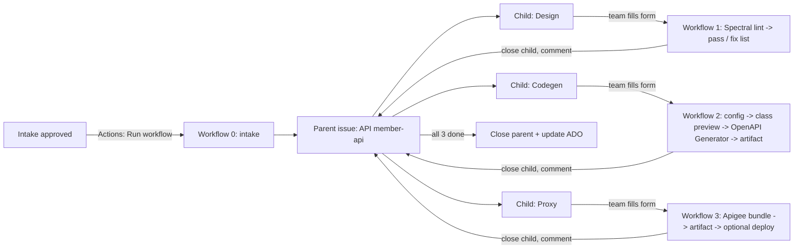

# API onboarding automation (POC)

One approved API intake → one GitHub tracking issue with three steps: **design check**, **code generation**, **Apigee proxy**.
Teams fill in a short form for each step. The automation does the rest and reports back to GitHub and ADO.
Nobody needs to read the docs or watch the video.

## How it works



- **Starting it:** once the intake is approved, someone runs **Actions → "0 - API intake" → Run workflow** and enters the API name (and ADO work item id, if any). Other ways to start it, including fully automatic from ADO, are listed in [Ways to start the intake](#ways-to-start-the-intake).
- Each child issue has a **"Fill in the details here"** link. It opens the right form with the API name, tracking issue and ADO work item already filled in.
- Wrong answer? The bot comments with a plain-language fix (e.g. "Package name can't contain dashes, try `com.example.memberapi`"). The team edits the issue and it runs again.
- Code generation comments a **preview of the class names** (`MembersApi`, `MemberDto`, ...) plus the download link.
- Every result is also posted as a comment on the ADO work item. When all three steps close, the parent closes and ADO can move to Done.

## What's in the repo

| Path | What it does |
|---|---|
| `azure-function/` | Optional. Starts the intake automatically from an ADO approval (see option C below) |
| `.github/workflows/intake.yml` | Creates the parent issue and 3 linked sub-issues |
| `.github/workflows/step-design.yml` | Lints the spec with Spectral using `.spectral.yaml` |
| `.github/workflows/step-codegen.yml` | Builds `codegen.yaml`, previews names, runs OpenAPI Generator, uploads code |
| `.github/workflows/step-proxy.yml` | Builds an Apigee proxy bundle, uploads it, optionally deploys |
| `.github/workflows/progress.yml` | Closes the parent if someone closes the last step by hand |
| `.github/ISSUE_TEMPLATE/` | The three forms |
| `scripts/` | All logic in plain Python (stdlib + PyYAML) |
| `scripts/authorize.py` | Who may start an onboarding and who may fill in each API's forms |
| `specs/member-api.yaml` | Sample spec for the demo |

## Setup

### 1. GitHub repo (10 min)
1. Create a repo (e.g. `api-onboarding-poc`) and push this folder to it.
2. **Settings → Actions → General → Workflow permissions:** "Read and write permissions".
3. Turn on **Issues** (Settings → General → Features).
4. Optional secrets/variables (Settings → Secrets and variables → Actions):

| Name | Type | Needed for |
|---|---|---|
| `SPEC_READ_TOKEN` | secret | Reading specs from *other* private repos (fine-grained PAT, Contents: read) |
| `ADO_ORG_URL` | variable | e.g. `https://dev.azure.com/example` |
| `ADO_PROJECT` | variable | ADO project name |
| `ADO_PAT` | secret | ADO PAT with Work Items: Read & write |
| `ADO_DONE_STATE` | variable | State to set when all steps finish, e.g. `Done` (leave empty to skip) |
| `APIGEE_ORG` | variable | Turns on deploy in the proxy step |
| `GCP_SA_KEY` | secret | Service account key with Apigee API Admin (better: Workload Identity Federation) |

Without the ADO and Apigee settings everything still works. Those updates are just skipped.

That's all the setup the default approach needs. The ADO comments and the move to Done only need the `ADO_*` settings above, not the Azure Function.

## Access control

| Who | Can do | How it's enforced |
|---|---|---|
| **Governance team** | Start an onboarding (Run workflow), fill in or fix any API's forms, change owners | Repo **Write** access + listed in the `GOVERNANCE` variable |
| **API owners** | Fill in the step forms for *their* API only | Listed on the parent issue's `**Owners:**` line. Repo **Read** or **Triage** access is enough |
| Anyone else with access | Open and read issues | Their form submissions are closed with "🔒 Not run" and nothing runs |

- **Starting an onboarding:** Run workflow needs Write access, and the intake also checks the person is in `GOVERNANCE` (a repo variable, e.g. `@alice, @bob`). If `GOVERNANCE` is empty, nobody can start one.
- **Owners** are entered by governance in the Run workflow form (`@alice, @bob`) and written on the parent issue. To change them, governance edits that line. Owners can't edit it themselves, because Read/Triage users can't edit issues the bot created.
- **Every form submit or edit** runs `scripts/authorize.py` first. It checks that the person who submitted or edited is an owner or in governance, and that the form points at a real bot-created step issue for the same API and step. Otherwise it comments the reason and closes the submission.
- **GitHub teams:** both lists also accept team slugs from the repo's org (e.g. `member-squad`). That needs the repo in an org and a `TEAM_READ_TOKEN` secret (a token with `read:org`). Without the token, team entries never match, so access fails closed.
- **Personal account repos:** every collaborator gets Write, so the `GOVERNANCE` check is what limits who can start an onboarding. Move to an org to give owners Read only.
- Tests: `python scripts/test_authorize.py`.

## Ways to start the intake

Only the very first workflow ("0 - API intake") needs a trigger. Everything after it (forms, design, codegen, proxy, ADO comments) works the same whichever option you use.

| Option | How it starts | Needs | Status |
|---|---|---|---|
| **A. Run workflow button (default)** | **Actions → "0 - API intake" → Run workflow**, enter API name, owners, ADO work item id, spec location | Being in `GOVERNANCE` | Ready |
| B. Script / CLI | `./scripts/demo_trigger.sh <org/repo> <api-name> "" "@alice, @bob"` | `gh` CLI logged in with write access | Ready |
| C. Azure Function + ADO service hook | Moving the ADO work item to *Approved* calls the function, which calls GitHub. Fully automatic and instant. | Azure Function App, GitHub PAT, ADO service hook | Code ready, see below |
| D. Power Automate / Logic App | Trigger "When a work item is updated" → check state is Approved → HTTP POST to `https://api.github.com/repos/<org>/<repo>/dispatches` with the body in `scripts/demo_trigger.sh` | Power Automate licence, GitHub PAT in the flow | Not built |
| E. Scheduled GitHub workflow polls ADO | A cron workflow asks ADO every few minutes for newly approved items and starts the intake for each. Automatic, no Azure, a few minutes' delay. | `ADO_PAT` secret | Not built |

> Why ADO's service hook can't call GitHub directly: ADO sends its own fixed payload, but GitHub's dispatch API needs a specific body (`event_type` + API details). Something in between (C, D or E) has to translate.

### Option C setup: Azure Function (15 min)
```bash
cd azure-function
cp local.settings.sample.json local.settings.json   # fill in values
python test_handler.py                               # 4 tests, no network needed
func azure functionapp publish <your-function-app>   # Azure Functions Core Tools, Python 3.11+
```
App settings to configure: `GITHUB_REPO`, `GITHUB_DISPATCH_TOKEN` (fine-grained PAT or GitHub App token with **Contents: write** on the repo, which `repository_dispatch` requires), `HOOK_USERNAME`, `HOOK_PASSWORD`, `TARGET_STATE`, and optionally `WORK_ITEM_TYPE`, `API_NAME_FIELD`, `SPEC_FIELD`.
No Core Tools? `az functionapp deployment source config-zip --build-remote true` deploys the same folder.

### Option C setup: ADO service hook (5 min)
Project Settings → Service hooks → **+** → **Web Hooks** → trigger **Work item updated**:
- Work item type: your intake type. Field: **State**.
- URL: `https://<app>.azurewebsites.net/api/ado-intake?code=<function key>`
- Basic auth username/password: same as `HOOK_USERNAME` / `HOOK_PASSWORD`.
- Resource details to send: **All**.

The function reads the API name from the `Custom.APIName` field (falls back to the title) and the spec link from `Custom.SpecLocation`. Change these with `API_NAME_FIELD` / `SPEC_FIELD`.

## Demo script (about 5 minutes)

1. **Kick off.** Run **Actions → "0 - API intake" → Run workflow** with API name `member-api` and owners `@<your-username>`. (Using option C? Move an intake to *Approved* in ADO instead.)
2. **Show the tracking issue.** Parent `[API] member-api` with 3 sub-issues and a progress bar.
3. **Design step.** Open `[Design] member-api` → click the form link → submit with `specs/member-api.yaml`. Shows "Design check passed" with suggestions. Tip: first submit a spec with a lowercase schema name to show the plain-language fix list.
4. **Code generation step.** Submit the form with Java - Spring Boot, model suffix `Dto`, API suffix `Api`, rename `MemberRecord: MemberEnvelope`. Then:
   - Show the class-name preview and the download link.
   - Edit the issue and type `com.example.member-api` as the package name to show the friendly validation message.
5. **Proxy step.** Submit with any `https://` backend URL. Download the bundle zip.
6. **Wrap up.** The parent closes automatically. If the `ADO_*` settings and a work item id were given, the ADO work item has a comment for each step and a link to the GitHub issue.

## Plugging in your existing pipeline

You already generate code from a config file merged to main. Two options:
- **Keep this POC's generator step.** It writes the same kind of config (`work/codegen.yaml`, shipped inside the artifact).
- **Reuse your pipeline.** In `step-codegen.yml`, replace "Generate code" and "Upload" with a step that opens a PR containing `work/codegen.yaml` in your config format (e.g. `peter-evans/create-pull-request`). Your current workflow runs on merge. Adjust `build_config()` in `scripts/codegen.py` to emit your exact field names.

## Notes and limits

- Issue forms can't hide fields, so the auto-filled ones say "please leave as is". The bot validates them.
- Issue changes made by the workflow's own token don't trigger other workflows. That's why `report.py` checks parent progress directly.
- `apigeecli` flags in `step-proxy.yml` should be checked against your installed version.
- For production: use a **GitHub App** instead of PATs, restrict who can open forms, add `CODEOWNERS` review for the proxy step, and move your real API standards into `.spectral.yaml`.

## Tested in the POC

- Azure Function logic: unit tests in `azure-function/test_handler.py`.
- Form parsing, validation messages, config + class preview, Spectral lint report, proxy bundle: run locally against the sample spec.
- Parent/child flow (create, close steps, auto-close parent, duplicate-event guard): simulated against a mock GitHub API.
- Full end-to-end run on GitHub (option B trigger → all 3 forms → parent auto-closed), including the OpenAPI Generator Docker step.
- **Not run yet:** Apigee deploy, ADO comments, and the Azure Function deployed in Azure (option C).
- Spring tip: the generator names the implementation `<interface>Controller`, so API suffix `Controller` gives `MembersControllerController`. Use `Api`.
